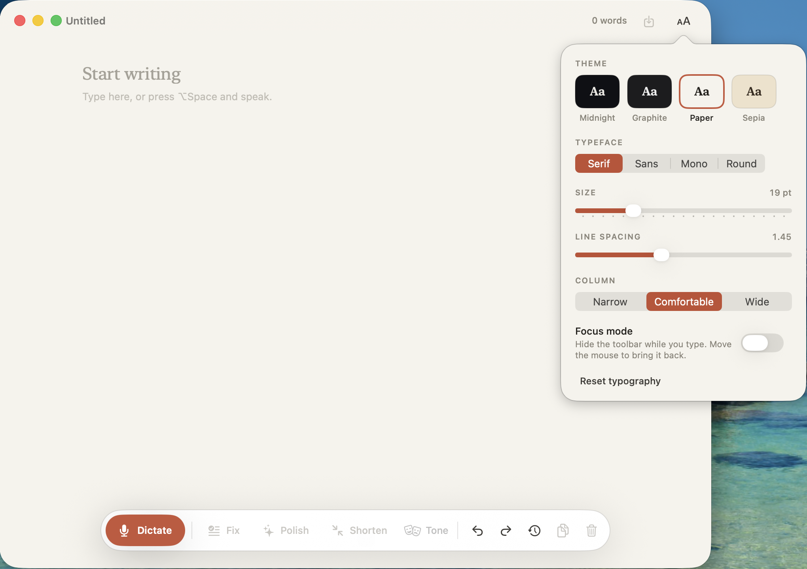
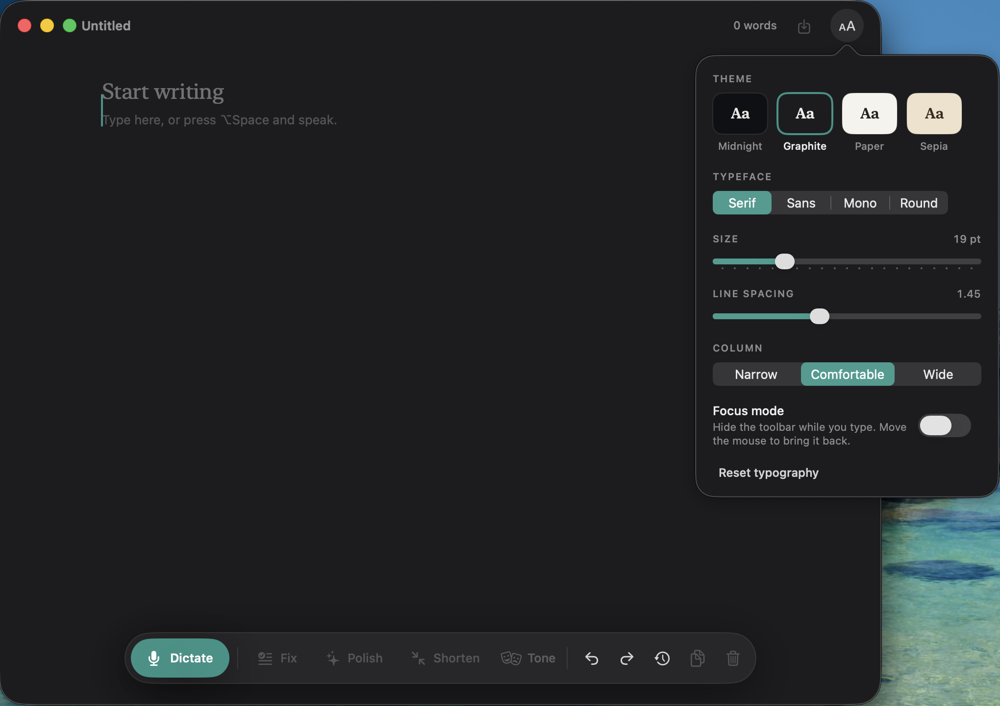
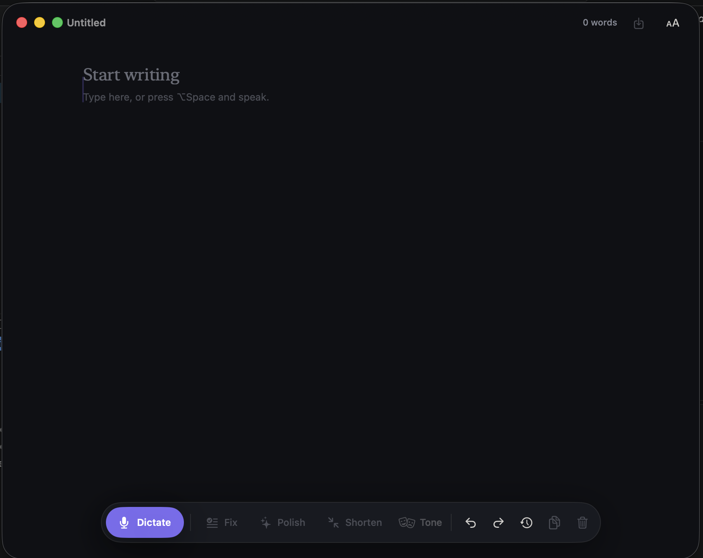

# Verba

Native macOS voice-to-text and writing assistant.

## Screenshots

  

  
  

## Features

- **Speak or type:** dictate with the microphone button or `⌥Space`, or just start typing. Dictation is added to what you already wrote.
- **Writing tools:** fix grammar, polish, shorten, or change tone (`⌘1`, `⌘2`, `⌘3`) using on-device Apple Intelligence.
- **Undo, redo, and history:** `⌘Z` works across typing, dictation, and AI edits, and the History popover keeps restorable snapshots between launches.
- **Personal look:** four themes (Midnight, Graphite, Paper, Sepia), four typefaces, adjustable size, line spacing, and column width.
- **Focus mode:** the toolbar fades while you type and returns when you move the mouse.
- **Drafts autosave** and can be exported as plain text with `⌘S`.

## Architectural direction

Verba is intentionally macOS-only and Swift-only. SwiftUI will own the visual components, while AppKit will handle the menu bar app, floating panels, global events, accessibility, and text insertion.

The first implementation should use explicit protocols around transcription, writing intelligence, and text insertion. This lets us test the state machine without requiring a microphone, Accessibility permission, or an Apple Intelligence-capable Mac.

## Patterns in use

- **State machine:** `VerbaSession` owns the legal lifecycle transitions.
- **Ports and adapters:** `Transcriber`, `TextInserter`, `WritingAssistant`, and `ActivationController` isolate system services from feature logic.
- **Coordinator/composition root:** `AppCoordinator` constructs and connects application services; UI and delegates do not create infrastructure directly.
- **MVVM where needed:** overlay screens will keep presentation state in view models instead of embedding behavior in SwiftUI views.
